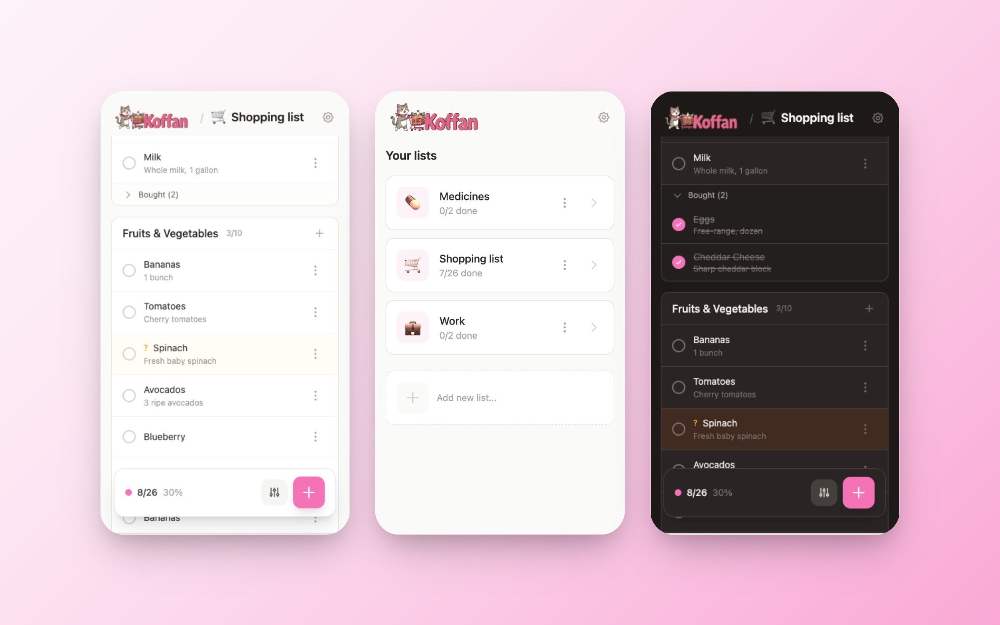

<p align="center">
  
</p>

<h1 align="center">Koffan</h1>

<p align="center">
  <strong>Free shopping assistant</strong><br>
  A fast and simple app for managing your shopping list together
</p>

<p align="center">
  <a href="https://railway.app/new/template?template=https://github.com/PanSalut/Koffan"></a>
  &nbsp;
  <a href="https://render.com/deploy?repo=https://github.com/PanSalut/Koffan"></a>
  &nbsp;
  <a href="https://cloud.digitalocean.com/apps/new?repo=https://github.com/PanSalut/Koffan/tree/main"></a>
  &nbsp;
  <a href="https://heroku.com/deploy?template=https://github.com/PanSalut/Koffan"></a>
</p>

---

## Screenshots

<p align="center">
  
</p>

---

## What does "Koffan" mean?

Pronounced **KOF-fan** (rhymes with "coffin" but with an "a" at the end). The name comes from the Polish word *"kochanie"* (meaning "darling" or "sweetheart"), which evolved into a playful nickname. It's a long story, but let's just say the name stuck! :D

## What is Koffan?

Koffan is a lightweight web application for managing shopping lists, designed for couples and families. It allows real-time synchronization between multiple devices, so everyone knows what to buy and what's already in the cart.

The app works in any browser on both mobile and desktop. Just one password to log in - no complicated registration required. If several households share one server, you can optionally give everyone their own login and keep separate lists for each household.

## Why did I build this?

I needed an app that would let me and my wife create a shopping list together and do grocery shopping quickly and efficiently. I tested various solutions, but none of them were simple and fast enough.

I built the first version in **Next.js**, but it turned out to be very resource-heavy. I have a lot of other things running on my server, so I decided to optimize. I rewrote the app in **Go** and now it uses only **~2.5 MB RAM** instead of hundreds of megabytes!

## Features

- **Ultra-lightweight** - ~16 MB on disk, ~2.5 MB RAM
- **Multiple lists** - Create separate lists for different stores or purposes, with custom icons
- **Accounts and workspaces (optional)** - Personal logins and separate lists for several households on one server ([details](#accounts-and-workspaces-optional))
- **PWA** - Install on your phone like a native app
- **Offline mode** - Create, edit and delete lists, sections and products without internet, with automatic synchronization when the connection returns
- **Auto-completion** - Fuzzy search suggestions from your history, remembers sections
- Organize products into sections (e.g., Dairy, Vegetables, Cleaning)
- Mark products as purchased
- Mark products as "uncertain" (can't find it in the store)
- Real-time synchronization (WebSocket)
- Responsive interface (mobile-first)
- **Dark mode** - Automatic theme based on system preferences
- Support for [18 languages](i18n/README.md#supported-languages), including all offline and synchronization messages
- Simple login - one shared password, or personal accounts with `MULTI_USER=true`
- Rate limiting protection against brute-force attacks
- **REST API** - Programmatic access for integrations and migrations ([docs](https://github.com/PanSalut/Koffan/wiki/REST-API))
- **Outbound webhooks** - Signed item events for automation tools such as n8n, Node-RED, and Zapier ([docs](https://github.com/PanSalut/Koffan/wiki/Webhooks))

## Shopping Offline

Open Koffan online and sign in once so the app and shopping data can be saved on your device. For offline page loads and the installed PWA, serve Koffan over HTTPS; `localhost` also works for development. A plain HTTP address on your home network does not provide the same offline support.

| What you can manage offline | Supported actions |
|-----------------------------|-------------------|
| Lists | Create, rename, change icons, reorder and delete |
| Sections | Create, rename, reorder, change sorting and delete |
| Products | Add, edit names and notes, change quantities, check/uncheck, mark as uncertain, move (to another section or another list), reorder and delete |
| Bulk actions | Check/uncheck an entire section, delete purchased products and delete selected sections |

You can create a new list with new sections and products entirely offline. Changes are saved on the device before the view updates and remain available after a page reload or reopening the app. When the connection returns, Koffan automatically sends pending changes and refreshes the list. Retrying a request after a lost response does not duplicate the same operation.

Other shoppers see your offline changes after they reach the server. Changes to different products are combined. For overlapping edits, the last value accepted by the server for each updated field wins. Saving product details sends its name, note and quantity together.

If a change cannot be applied, for example because another shopper deleted the edited product, it stays pending and the app offers retry and discard controls. Discarding a failed change can also remove local changes that depend on it.

Initial setup and login, imports, history management and switching workspaces require a connection. Clearing site data removes unsynchronized changes, and browser or operating-system storage cleanup can also remove offline data. With [accounts](#accounts-and-workspaces-optional), the offline copy belongs to one account and workspace: switching to another workspace, or signing in with another account in the same browser, removes it, including changes that have not been synchronized yet. Let pending changes synchronize (or retry or discard failed ones) before you switch.

## Tech Stack

- **Backend:** Go 1.25+ (Go 1.26.6 toolchain) + Fiber
- **Frontend:** HTMX + Alpine.js + Tailwind CSS
- **Database:** SQLite

## Upgrading

> **Upgrading to 2.16.0? Back up your database file first.** On its first start, 2.16.0 migrates the database (item history becomes per workspace), whether or not you enable accounts. Older versions cannot save item history on a migrated database, and they ignore workspaces, so anyone with the shared password would see the lists of every workspace. There is no downgrade path: to go back, stop Koffan and restore the backup (changes made since then are lost). The database is the file set in `DB_PATH` (`/data/shopping.db` in Docker).

## Local Setup (without Docker)

You can run Koffan directly on your machine using Go. This works on any system (macOS, Linux, Windows).

### 1. Install Go

**macOS (Homebrew):**
```bash
brew install go
```

**Linux (Debian/Ubuntu):**
```bash
sudo apt install golang-go
```

**Windows:**
Download from [go.dev/dl](https://go.dev/dl/)

### 2. Clone and Run

```bash
git clone https://github.com/PanSalut/Koffan.git
cd Koffan
go run .
```

App available at http://localhost:3000

Default password: `shopping123`

To set a custom password:
```bash
APP_PASSWORD=yourpassword go run .
```

The stylesheet `static/app.css` is prebuilt with Tailwind CSS. After changing classes in `templates/` or `static/*.js`, rebuild it (Node.js required):
```bash
npm install
npm run build:css
```

## Arch Linux (AUR)

Arch Linux users can install Koffan from the [AUR](https://aur.archlinux.org/packages/koffan) using an AUR helper:

```bash
yay -S koffan
```

> The AUR package is community-maintained by [@SergeantBiggs](https://github.com/SergeantBiggs), not by the Koffan project.

## Docker

> **Upgrading from 2.9.x or earlier?** The default container port changed from `80` to `8080` in 2.10.0 so the image can run as a non-root user. If you are upgrading, update your port mappings and any reverse proxy upstreams accordingly:
>
> - `docker run -p 80:80` → `docker run -p 80:8080`
> - `docker run -p 3000:80` → `docker run -p 3000:8080`
> - Reverse proxies (nginx / Caddy / Traefik): point the upstream to the container's port `8080`
> - If you previously overrode `PORT` via env to work around the privileged port, you can drop that override
>
> Coolify and other auto-discovery setups that read the image's `EXPOSE` will pick up the new port on redeploy without any manual change.

### Quick Start (recommended)

```bash
docker run -d -p 3000:8080 -e APP_PASSWORD=yourpassword -v koffan-data:/data ghcr.io/pansalut/koffan:latest
```

App available at http://localhost:3000

### Build from source

```bash
docker compose -f docker-compose.local.yaml up -d
# App available at http://localhost:8080
```

`docker-compose.yaml` only exposes the port to other containers (for Coolify and reverse proxies); `docker-compose.local.yaml` also publishes it on the host.

## Environment Variables

| Variable | Default | Description |
|----------|---------|-------------|
| `APP_ENV` | `development` | Set to `production` for secure cookies |
| `APP_PASSWORD` | `shopping123` | Shared login password; with `MULTI_USER`, the password of the first administrator |
| `SESSION_DURATION` | `168h` (7 days) | How long login sessions remain valid; use duration syntax such as `30m`, `12h`, `1d` or `7d` |
| `DISABLE_AUTH` | `false` | Set to `true` to disable authentication (for reverse proxy setups) |
| `PORT` | `8080` (Docker) / `3000` (local) | Server port |
| `HTTP_READ_BUFFER_SIZE` | `16384` | Max size in bytes for request headers (raise if you see HTTP 431 behind an SSO proxy) |
| `DB_PATH` | `./shopping.db` | Database file path |
| `DEFAULT_LANG` | `en` | Default UI language ([supported codes](i18n/README.md#supported-languages)) |
| `LOGIN_MAX_ATTEMPTS` | `5` | Max failed login attempts before lockout; set to `0` to disable login rate limiting |
| `LOGIN_WINDOW_MINUTES` | `15` | Time window for counting attempts |
| `LOGIN_LOCKOUT_MINUTES` | `30` | Lockout duration after exceeding limit |
| `API_TOKEN` | *(disabled)* | Enable REST API with this token ([docs](https://github.com/PanSalut/Koffan/wiki/REST-API)) |
| `MULTI_USER` | `false` | Set to exactly `true` to enable accounts and workspaces ([see below](#accounts-and-workspaces-optional)); ignored when `DISABLE_AUTH=true` |
| `ADMIN_USER` | `admin` | With `MULTI_USER`: username of the first administrator, created on the first start with accounts enabled, using `APP_PASSWORD` |
| `API_WORKSPACE_ID` | `1` | With `MULTI_USER`: id of the workspace the REST API token works on ([details](#rest-api-and-webhooks-with-accounts)); ignored without `MULTI_USER` |
| `WEBHOOK_URL` | *(disabled)* | HTTP or HTTPS endpoint for outbound item events |
| `WEBHOOK_SECRET` | *(none)* | Secret used to sign webhook payloads with HMAC-SHA256 |
| `WEBHOOK_EVENTS` | *(all item events)* | Comma-separated filter: `item.created`, `item.updated`, `item.completed`, `item.deleted` |

`SESSION_DURATION` accepts Go duration units such as `m` (minutes) and `h` (hours), plus a whole-number `d` suffix for full 24-hour days (for example, `1d` or `7d`). Day values are specified on their own; the other units can be combined (for example, `1h30m`).

### Accounts and Workspaces (optional)

By default Koffan has one shared password and behaves exactly as before. Set `MULTI_USER=true` (exactly that value) to give every person their own login and to keep separate lists for several households on one server.

#### Turning accounts on

1. Back up your database file (see [Upgrading](#upgrading)).
2. Set `MULTI_USER=true` and your own `APP_PASSWORD` (at least 8 characters). Optionally set `ADMIN_USER` (default `admin`). If `APP_PASSWORD` is still the built-in default `shopping123`, the administrator gets that password and the log shows a warning: change it right after signing in.
3. Restart Koffan and look for `Created administrator "admin"` in the log. Everyone signed in with the shared password is signed out.
4. Sign in as the administrator and open *Manage workspaces* from the workspace menu in the header. Create an account for each person and keep *Add to the current workspace* ticked to put them in "Home", the default workspace that holds all your existing lists.

With Docker Compose, put the settings in a `.env` file next to the compose file:

```bash
MULTI_USER=true
APP_PASSWORD=choose-a-long-password
ADMIN_USER=admin
```

#### How it works

- A **workspace** is a group of lists, templates and autocomplete history shared by the people in it (a household, the in-laws, a parent), with a name and an icon. One person can belong to several workspaces and switch between them from the header.
- Everyone in a workspace sees its lists; people outside it cannot.
- Anyone signed in can create a workspace and becomes its owner. Owners rename it, change its icon, add and remove people, clear its data and delete it. Members use its lists and can leave it. "Home" cannot be deleted.
- **Administrators** create and delete accounts and set new passwords. They can also manage any workspace (rename it, delete it, add or remove people), even one they are not in, but they only see its lists after adding themselves to it, which shows them in its member list. The first administrator is created from `ADMIN_USER` and `APP_PASSWORD`; the last administrator cannot be deleted.
- There is no e-mail or self-service sign-up: an administrator creates the account and hands over the username and password. Usernames have up to 40 characters, no spaces or commas, and are not case-sensitive.
- Everyone can change their own password under *Your account* on the *Workspaces* page. The current password is required, wrong guesses count against the login rate limit, and the change signs you out on your other devices. A password set by an administrator (for someone who forgot theirs) signs that account out everywhere.
- Export, import and *Clear database* work on the current workspace only. Only its owners and administrators can clear it.
- Real-time updates only reach the people in the workspace that changed. Someone who is removed from a workspace, deleted, signed out or given a new password stops receiving them at once.
- `APP_PASSWORD` is only used to create the first administrator; changing it later changes no one's password. Keep it set anyway: if you turn accounts off again, it becomes the shared password again (without it, the built-in default `shopping123` applies).
- Turning accounts off again brings back the shared password. Nothing is deleted, but only "Home" is reachable (the other workspaces return when you turn accounts on again), and account sessions stop working.
- `DISABLE_AUTH=true` (for example with forward-auth at a proxy) turns accounts off.

#### REST API and webhooks with accounts

- The REST API token works on one workspace, `API_WORKSPACE_ID` (default `1`, "Home"). Anything in other workspaces behaves as if it did not exist. Find workspace ids with `sqlite3 /path/to/shopping.db "SELECT id, name FROM workspaces;"`. While the API is enabled, that workspace cannot be deleted; if it is missing, the API answers `503`.
- **Outbound webhooks are not per workspace.** `WEBHOOK_URL` receives the item events of every workspace, including list and section names, and the payload carries no workspace id. On an instance shared by several households, leave webhooks disabled unless everyone trusts the receiver.

#### Behind a reverse proxy

- Login rate limiting counts attempts per client IP, and Koffan does not read forwarded IP headers. Behind a reverse proxy all accounts therefore share one limit, and one person's wrong passwords can lock everyone out for `LOGIN_LOCKOUT_MINUTES`. Set `LOGIN_MAX_ATTEMPTS=0` and limit login attempts at the proxy instead (see [Login Rate Limiting](#login-rate-limiting)).
- With accounts, Koffan refuses changes and live updates requested by pages from other origins. Over HTTPS the browser reports where a request comes from. Over plain HTTP, Koffan compares the request's `Origin` with its `Host`, so a proxy serving Koffan over plain HTTP must pass the original `Host` header or set `X-Forwarded-Host`. Caddy and Traefik do this by default; with nginx add `proxy_set_header Host $host;`.

#### Forgotten administrator password

With a second administrator, they can simply set a new password. If the only administrator forgot theirs:

1. Back up the database file and stop Koffan.
2. Delete all accounts: `sqlite3 /path/to/shopping.db "PRAGMA foreign_keys=ON; DELETE FROM users;"`. For the Docker volume from the Quick Start: `docker run --rm -v koffan-data:/data alpine sh -c 'apk add --no-cache sqlite >/dev/null && sqlite3 /data/shopping.db "PRAGMA foreign_keys=ON; DELETE FROM users;"'`
3. Start Koffan again with `MULTI_USER=true` and a new `APP_PASSWORD`. The administrator is created again and owns "Home". All other accounts are removed as well, so create them again. Their workspaces and lists are kept: add yourself to each workspace as administrator and add the people back.

### Login Rate Limiting

If your reverse proxy already handles rate limiting (for example, Traefik with CrowdSec), set `LOGIN_MAX_ATTEMPTS=0` in the container environment and restart Koffan. This disables the built-in login limiter while keeping password authentication enabled. `LOGIN_WINDOW_MINUTES` and `LOGIN_LOCKOUT_MINUTES` have no effect when the limiter is disabled.

### Outbound Webhooks

Set `WEBHOOK_URL` to receive signed, asynchronous item events. Koffan supports event filtering, HMAC-SHA256 signatures, and durable SQLite-backed retries that survive restarts.

```bash
WEBHOOK_URL=https://automation.example.com/webhook/koffan \
WEBHOOK_SECRET=replace-with-a-random-secret \
WEBHOOK_EVENTS=item.created,item.completed,item.deleted \
go run .
```

See the [Webhook documentation](https://github.com/PanSalut/Koffan/wiki/Webhooks) for events, payloads, signature verification, retry behavior, and integration guidance.

## Deploy to Your Server

### Docker

```bash
git clone https://github.com/PanSalut/Koffan.git
cd Koffan
docker build -t koffan .
docker run -d -p 80:8080 -e APP_PASSWORD=your-password -v koffan-data:/data koffan
```

### Coolify

1. Add new resource → **Docker Compose** → Select your Git repository or use `https://github.com/PanSalut/Koffan`
2. Set domain in **Domains** section
3. Enable **Connect to Predefined Network** in Advanced settings
4. Add environment variable `APP_PASSWORD` with your password
5. Deploy

### Persistent Storage

Data is stored in `/data/shopping.db`. The volume ensures your data persists across deployments.

## Documentation

- [Offline behavior](#shopping-offline) - Capabilities, synchronization and limitations
- [Accounts and workspaces](#accounts-and-workspaces-optional) - Personal logins and separate lists for several households
- [Translation guide](i18n/README.md) - Supported languages and updating translations

For more information, check the **[Wiki](https://github.com/PanSalut/Koffan/wiki)**:

- [REST API](https://github.com/PanSalut/Koffan/wiki/REST-API) - Programmatic access, migrations, integrations
- [Webhooks](https://github.com/PanSalut/Koffan/wiki/Webhooks) - Outbound item events for automation and notifications
- [Multiple Instances](https://github.com/PanSalut/Koffan/wiki/Multiple-Instances) - Running separate instances for different households (or use [accounts and workspaces](#accounts-and-workspaces-optional) on one instance)

## Feature Requests

Have an idea? Check [open feature requests](https://github.com/PanSalut/Koffan/issues?q=is%3Aissue+is%3Aopen+label%3Aenhancement) and vote with 👍 on the ones you want most.

Want to suggest something new? [Create an issue](https://github.com/PanSalut/Koffan/issues/new).

## Sponsors

I love and admire the open source philosophy. That's why I created Koffan - to give back to the community that has given me so much over the years.

If you find this project useful and want to support my work (completely optional!), you can become a sponsor:

[](https://github.com/sponsors/PanSalut)

### Thank You

I'm incredibly grateful to these amazing people for supporting Koffan:

- [@chip-well](https://github.com/chip-well)
- [@Pffeffi](https://github.com/Pffeffi)
- [@nathan-synfo](https://github.com/nathan-synfo)
- [@van-nutno](https://github.com/van-nutno)
- [@kazoob](https://github.com/kazoob)
- [@monkyOfTheSCC](https://github.com/monkyOfTheSCC)

## License

MIT License with [Commons Clause](https://commonsclause.com/).

You are free to use, modify, and share this software for any purpose, including commercial use within your organization. However, you may not sell the software or offer it as a paid service.
